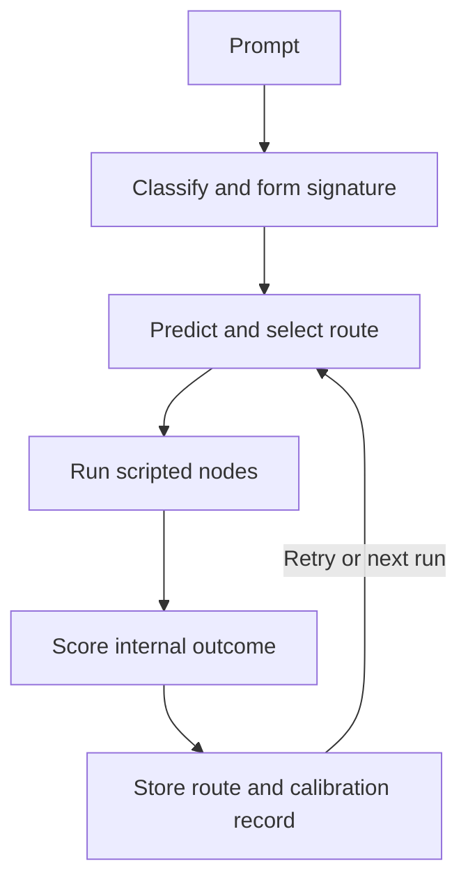

# Regret-Aware Agent Scaffold

> **ĀRU Decision Evidence Lab · Research release**
>
> **Independent human-gold benchmark:** on 2,000 questions from Stanford SQuAD v1.1, a question-aware sentence retriever selected the answer-containing sentence **82.1%** of the time versus **78.5%** for the lexical baseline (**+3.6 percentage points**). The exploratory article-cluster bootstrap interval was **+2.47 to +4.61 points**. One topic regressed, and the review gate blocked advancement. **This is sentence retrieval, not proof of better LLM reasoning or general intelligence.**
>
> **Evidence:** [Reproducible benchmark record](BENCHMARK_EVIDENCE.md) · [Commercialization blueprint](COMMERCIALIZATION.md) · [Decision Evidence Lab CI](https://github.com/aruintelligence/regret-aware-agent-scaffold/actions)

A dependency-free Python **routing simulator** for studying how an agent controller can remember prior routes and calibrate predictions after each attempt. Created by Daniel Jacob Read IV and Shane Travis Horman (ĀRU Intelligence).

This is a scaffold with scripted specialist nodes. It does not call an LLM, browse, solve arbitrary prompts, measure cognition, or validate real-world task success. Its “quality” and “confidence” are internal proxy values defined by the code.

## Run it

Requires Python 3.9 or newer; no package installation is needed.

```bash
python3 regret_aware_scaffold.py --runs 5
python3 regret_aware_scaffold.py --prompt "Research a route evaluation method" --runs 3 --json
python3 regret_aware_scaffold.py --runs 5 --memory-file route_memory.json
python3 -m unittest discover -s tests -v
python3 benchmark.py --runs 5
```

The optional memory file stores route observations as local JSON. Without it, memory lasts for the current process only. The benchmark deliberately uses fresh in-memory runtimes so its results are independent of saved files.

## How the loop works



Route memory stores only the selected specialist route. Calibration compares past outcomes for the same task signature, route, and retry depth. Sparse observations are blended with the initial heuristic instead of replacing it outright. A `historical_regret` record describes the gap to a previous observed score at that depth; it is **not** a counterfactual estimate of an untried route.

## Reproducible internal comparison

`benchmark.py` runs each prompt five times in two arms: **cold** creates a new runtime for every attempt; **warm** reuses the same runtime for that prompt. The table compares rounds 2–5. These are deterministic examples with fixed scripted nodes, not independent task labels.

| Prompt | Mean executed nodes, cold → warm | Mean absolute prediction error, cold → warm | Mean internal quality, cold → warm |
|---|---:|---:|---:|
| Design | 26 → 26 | 0.186 → 0.073 | 0.666 → 0.666 |
| Research | 26 → 26 | 0.236 → 0.114 | 0.646 → 0.646 |
| Mixed | 37 → 26 | 0.267 → 0.084 | 0.667 → 0.658 |

The warm controller predicts its own proxy score more closely on these fixtures and uses one fewer retry on the mixed fixture. Its internal quality score is slightly **lower** on that fixture. This is evidence of a software behavior change, not evidence that it gives better answers or has become more intelligent. Run the command above to inspect all individual records and challenge these results.

## What this repair addresses

- Task signatures are now formed after the signal is available, so saved observations can be retrieved on a later run.
- Stored routes are comparable to planner candidates; old full execution traces are excluded from route hints.
- The quality function charges the selected specialist route and a separate retry penalty rather than charging every control and evaluation node repeatedly.
- Calibration can move predictions up or down using outcomes at the same retry depth.
- Displayed confidence is capped by the internal score after evaluation; a failed gate cannot still report a perfect score.
- A small CLI, regression tests, and a cold/warm comparison replace the previous demo's unverified improvement claims.

## Research boundary

The evaluator and specialists are hand-authored. No ground-truth outcome or held-out real task is available here. Better calibration to this evaluator can coexist with worse real-world performance. A stronger next experiment would define externally graded tasks and compare this planner against a fixed policy with matched prompts, budgets, and independently specified success criteria.

MIT licensed; see [LICENSE](LICENSE). Project concepts relate to the [Divine Whisper lineage](https://github.com/aruintelligence/divine-whisper-ecosystem) and Inward Physics™ research.


## Decision Evidence Lab (experimental, opt-in)

The **ĀRU Decision Evidence Lab** adds a measurable research workflow without changing the default scaffold. It is a **routing experiment**, not a deployed LLM, a verified improvement in task performance, or evidence of AGI. It logs the probability of each selected specialist route, accepts **separately graded** outcomes, compares candidate routing policies with inverse-propensity weighting, and generates a polished offline HTML dashboard.

**Quick start: reproducible synthetic demonstration**

```bash
python3 experiment_cli.py demo --out-dir demo-report --n 900 --seed 7
# Open demo-report/index.html locally
python3 -m unittest discover -s tests -v
```

The synthetic generator intentionally assigns different success probabilities to three scripted routes. The results **only verify the evaluation pipeline**. The report prominently identifies synthetic data and *always* blocks rollout, even if the candidate appears superior.

**Actual decision logging (no fabricated outcome labels)**

```bash
# Create prompts.txt yourself, with one non-sensitive task per line.
python3 experiment_cli.py collect --prompts prompts.txt --decisions experiment-data/decisions.jsonl --epsilon 0.25 --seed 7

# Independently evaluate a completed route with a preregistered rubric.
# Replace DECISION_ID with the ID printed by collect.
python3 experiment_cli.py label \
  --decisions experiment-data/decisions.jsonl \
  --labels experiment-data/labels.jsonl \
  --decision-id DECISION_ID --reward 0.8 \
  --grader external-evaluator-1 --rubric-id rubric-v1 \
  --source-kind external

python3 experiment_cli.py evaluate \
  --decisions experiment-data/decisions.jsonl \
  --labels experiment-data/labels.jsonl \
  --baseline-policy greedy --candidate-policy shortest \
  --report-json experiment-data/report.json \
  --report-html experiment-data/index.html
```

The `collect` command uses an opt-in `ExperimentRuntime` with **one specialist route per task and no retries**. The original `MasterAgentRuntime` remains unchanged. This matters: assigning a final outcome to one action would be misleading if a later retry changed the result. The logged action is chosen with epsilon-greedy randomization, and the stored propensity is validated against the logged candidate set. No raw prompt, name, or user ID is written to the decision log. Task signatures and routes may still reveal information; use non-sensitive inputs and appropriate data retention policies.

**What is estimated**

- **IPS:** mean of externally graded rewards weighted by inverse logged action probability; may exceed the reward range in finite samples.
- **SNIPS:** self-normalized IPS estimate; more stable in some cases but generally biased in finite samples.
- **ESS:** effective sample size, warning of weak support even when the log is large.
- **Paired bootstrap difference:** the candidate minus baseline SNIPS on the *same resampled tasks*. The percentile interval is exploratory and assumes independent observations.
- **Conservative human-review screen:** checks sample size, complete labels, overlap, ESS, weight clipping, label provenance, and whether the exploratory lower interval exceeds a specified uplift. **It never authorizes automatic policy rollout.**

Available deterministic candidate policies are `greedy` (original highest-score route), `shortest` (fewest nodes), and `evidence_first` (first route containing the evidence node, otherwise greedy). The baseline and candidate policies must be chosen *before* collecting outcomes to avoid selection bias. This implementation does not learn a new production policy from its own internal quality score.

**Scientific and engineering limits**

1. Specialist nodes are scripted placeholders. Their internally generated quality metrics are **not** valid external labels. External graders must use a fixed rubric and ideally be blind to the route chosen.
2. The logging policy can adapt as memory changes. Standard independent-task bootstrap intervals are not automatically valid for adaptive data, repeated tasks, correlated users, or delayed rewards. A preregistered prospective experiment with cluster-aware or sequential inference is needed for consequential claims.
3. Self-attested external labels are not cryptographically authenticated. JSONL is a **single-process research log**, not a transactional or tamper-proof enterprise ledger. It requires authorization, privacy review, secure storage, provenance, and independent audit before production use.
4. The report measures policy value on observed task contexts only. It cannot establish improvements on new tasks, changes in distribution, or arbitrary real-world outcomes.
5. The review gate is an advisory screening tool, not a causal proof, regulatory certification, or authorization to deploy.

**Commercialization path:** integrate an actual task executor and independent grader, preregister external benchmark rubrics, randomize policy assignments under a fixed task budget, add authenticated append-only event storage, validate on held-out customers/tasks, and provide governance/rollback before selling an enterprise decision-assurance product.

The GitHub Actions workflow tests Python 3.9 and 3.12, runs the existing internal benchmark, generates a synthetic evidence report, and publishes that report as a workflow artifact. No external Python dependencies are required.


### Advanced diagnostics and evidence attestation

The report also includes an **out-of-fold doubly robust (DR) diagnostic**. A shrinkage reward model is trained on other folds and predicts outcomes using the pre-decision task signature and route. The model is deliberately simple and is not independently validated; the DR estimate is a second estimator, **not a second experiment**. Domain-level segment diagnostics flag an observed negative policy difference only when both policies have minimum effective support. These are investigation signals, not demographic fairness claims or confirmatory tests.

For an auditable research handoff, create a checksum manifest over the decision log, outcome labels, and JSON report:

```bash
python3 experiment_cli.py attest \
  --decisions experiment-data/decisions.jsonl \
  --labels experiment-data/labels.jsonl \
  --report-json experiment-data/report.json \
  --manifest experiment-data/attestation.json

python3 experiment_cli.py verify \
  --decisions experiment-data/decisions.jsonl \
  --labels experiment-data/labels.jsonl \
  --report-json experiment-data/report.json \
  --manifest experiment-data/attestation.json
```

For **HMAC authentication**, securely provision an environment variable named `ARU_EVIDENCE_HMAC_KEY` with at least 16 bytes of secret material and add `--hmac-key-env ARU_EVIDENCE_HMAC_KEY` to both commands. Do not commit or share the secret. An HMAC-authenticated manifest can detect modifications when the key remains private; it does **not** prove the underlying labels are truthful, stop someone deleting the files, or make JSONL immutable. Store the attestation outside the experimental data store to establish a separate trusted anchor.

**Commercial safety principle:** a policy can show a positive overall estimate while performing worse in a specific task domain. The human-review screen blocks advancement when a sufficiently supported domain exhibits a material observed decline. Even a passed screen cannot trigger automatic rollout.


### Instrument an external agent (vendor-neutral adapter)

A real AI orchestration system can call the dependency-free `external_adapter.log_instrumented_decision` **at the moment it makes a prospective randomized decision**. This creates the same schema used by the evaluator, without importing the scripted scaffold runtime:

```python
from external_adapter import log_instrumented_decision

# These probabilities must come from the ACTUAL randomized controller.
# Here, an external controller has already selected the second route.
event = log_instrumented_decision(
    "experiment-data/decisions.jsonl",
    task_signature="research|public-data",
    candidate_routes=[
        ["research_node", "truth_evidence_node"],
        ["coherence_node"],
    ],
    selected_route=["coherence_node"],
    selection_probabilities=[0.8, 0.2],
    predicted_scores=[0.8, 0.5],
)
print(event["decision_id"])  # Join an independent outcome later.
```

The adapter validates full-support categorical probabilities, their sum, candidate identity, and the logged propensity. **It cannot verify that the external system actually used those probabilities**. Never infer or invent propensities retrospectively, and do not submit tasks where randomized exploration would create unacceptable risk. The adapter is not a production API: there is no authentication, concurrency control, encryption, consent workflow, or verified executor integration. Those remain explicit engineering requirements.


### Falsification benchmark: known ground truth

`scientific_validation.py` generates a contextual bandit with three routes, three task signatures, and **published analytic reward probabilities**. Unlike a self-scoring demo, the true expected policy uplift is known from the simulator's explicit probability table. Repeated randomized trials measure IPS, SNIPS, and cross-fitted DR estimation bias, absolute error, RMSE, and exploratory interval coverage:

```bash
python3 scientific_validation.py --trials 40 --n 900 --seed 7 --json validation.json
```

This is a genuine, falsifiable **software/statistics test**, but it is **not evidence of a better real-world AI**: the reward-generating distribution is artificial, the tasks are scripted, and no independent customer outcomes are used. Passing such a test means the estimators behave plausibly on this specified environment. The next scientific milestone is a prospective, externally graded, held-out evaluation on real tasks with an agreed baseline and budget.


## Human-annotated, independently scored retrieval benchmark

The `squad_benchmark.py` experiment moves beyond synthetic rewards to **actual retrieval decisions** scored against independently published human annotations from the [Stanford SQuAD v1.1 development dataset](https://rajpurkar.github.io/SQuAD-explorer/). The dataset is CC BY-SA 4.0 and **is not included in this repository**.

Two fixed, dependency-free algorithms see the same **question and source passage, but never the annotated answers**:

- **Baseline:** lexical question/sentence overlap normalized for sentence length.
- **Challenger:** sentence-level BM25/IDF with query coverage, token proximity, and a modest numeric-question cue.

The outcome is 1 if the selected sentence **fully contains a human-annotated answer span** and 0 otherwise. This is a legitimate sentence-retrieval benchmark, **not a complete QA system, an LLM benchmark, or proof of agent intelligence**. Both routes run on each question for a direct *full-information audit*. Separately, a 50/50 randomized logging policy reveals only the selected route's reward to the off-policy evaluator. The report compares off-policy estimates with the directly observable true policy difference on the same fixed benchmark questions.

```bash
# Download from Stanford (dataset not redistributed by ĀRU):
curl -fL https://rajpurkar.github.io/SQuAD-explorer/dataset/dev-v1.1.json -o dev-v1.1.json

# Reproducible evaluation of a fixed hash-selected 2,000-question subset:
python3 squad_benchmark.py --dataset dev-v1.1.json \
  --out-dir benchmark-report --limit 2000 --seed 20261018 --replicates 400
# View benchmark-report/index.html
# Inspect benchmark-report/oracle.json for full-information scores.
```

GitHub Actions workflow `squad-human-gold.yml` downloads the official dataset during the run, prints its SHA-256, executes the benchmark, and uploads only the resulting reports. The raw dataset is not committed or archived. Benchmark labels derive from human-annotated answer offsets, but the grading implementation is ours and must be independently audited before claims about performance. The SQuAD *development* set is public; these are reproducible exploratory measurements, **not hidden-test leaderboard results**. Any later tuning on the same data invalidates treating that data as an untouched holdout.

The strongest scientific claim supported by this benchmark is about the **specific sentence retrieval algorithms on the specific annotated task**. It does not prove a general improvement in the underlying Divine Whisper scripted agent, nor does it establish a commercial product.


## Opt-in real LLM evaluation (LM Studio / OpenAI-compatible)

**A genuine model endpoint is required; none is bundled or simulated as a real model.** The `llm_squad_benchmark.py` adapter can evaluate a real local model against SQuAD human gold answers. It compares two *prompt-routing strategies* (direct concise answer vs explicitly grounded extractive answer) with a 50/50 randomized logging policy and independent normalized token-F1 grading. This is an actual model execution only when the operator connects a real running model.

```bash
# Start an OpenAI-compatible local server (for example LM Studio on port 1234).
# Download official SQuAD dev JSON as described above.
python3 llm_squad_benchmark.py \
  --dataset dev-v1.1.json \
  --out-dir local-llm-report \
  --model YOUR_LOADED_LOCAL_MODEL_NAME \
  --endpoint http://127.0.0.1:1234/v1/chat/completions \
  --limit 20 \
  --acknowledge-model-calls
```

The command refuses to make model requests unless `--acknowledge-model-calls` is supplied. By default only loopback endpoints are allowed. A remote endpoint additionally requires HTTPS and `--allow-remote`, which may incur third-party costs and transmit the SQuAD passage and question to that service. Optional API credentials are read from the `ARU_LLM_API_KEY` environment variable; never put API keys in command lines or repository files. Redirects are blocked to prevent escaping the chosen endpoint. The HTTP adapter enforces request timeouts, prompt/output limits, and a maximum of 500 requests per run. Each decision is logged *before* execution; failed model requests receive no fabricated outcome label.

The repository CI tests the LLM HTTP contract with a local **mock server**. Those mock tests prove API plumbing, safety boundaries, and grading code; they do **not** prove any model's performance. A real LM Studio server/model is not available to GitHub Actions by default, so real model results must be produced and inspected by the operator. The SQuAD public dev set is not a hidden test and should not be used for post-hoc leaderboard claims.


## Loopback-only Decision Evidence Gateway (research API)

`evidence_gateway.py` provides a **local HTTP API** backed by SQLite WAL transactions and an optional HMAC-authenticated event hash chain. This is a step toward a deployable product, but it is **not an internet-facing service**: no TLS, user accounts, SSO/RBAC, multi-tenancy, consent verification, deletion/retention workflow, encryption at rest, or external security audit.

```bash
# Generate separate secrets securely; never commit them or paste into chat.
export ARU_GATEWAY_API_KEY="$(python3 -c 'import secrets; print(secrets.token_urlsafe(32))')"
export ARU_GATEWAY_HMAC_KEY="$(python3 -c 'import secrets; print(secrets.token_urlsafe(32))')"

# Start a loopback-only service.
python3 evidence_gateway.py serve --db experiment-data/gateway.db --port 8765

# In another terminal, POST a validated event:
# Authorization: Bearer <ARU_GATEWAY_API_KEY>
# X-ARU-Consent: research-opt-in
# Content-Type: application/json
# POST http://127.0.0.1:8765/v1/decisions
# POST http://127.0.0.1:8765/v1/labels
# GET  http://127.0.0.1:8765/v1/chain

# Offline audit/export for the evaluation CLI:
python3 evidence_gateway.py verify --db experiment-data/gateway.db
python3 evidence_gateway.py export --db experiment-data/gateway.db \
  --decisions experiment-data/gateway-decisions.jsonl \
  --labels experiment-data/gateway-labels.jsonl

# One command to export, evaluate, render, and HMAC-attest an evidence passport:
python3 evidence_gateway.py report --db experiment-data/gateway.db \
  --out-dir experiment-data/gateway-passport \
  --baseline-policy greedy --candidate-policy shortest --replicates 300
# Open experiment-data/gateway-passport/index.html
```

The service enforces API-key authentication, an explicit research opt-in header, strict schema allowlists that reject raw prompt fields, unique decision IDs, idempotent retries, label-to-decision references, and tamper-detection checks. Events are append-only at the API level; SQLite administrators and anyone holding the HMAC key can still alter or delete storage. An external trusted digest anchor, database backups, retention/deletion controls, authenticated user consent, and operational security are required before using real customer data. **Do not expose this HTTP server to the public internet.**


## Architecture: a decision can carry its evidence

```mermaid
flowchart LR
  A["Local LLM / External agent"] --> B["Prospective route decision"]
  B --> C["Consent-gated loopback API"]
  C --> D["SQLite event log + HMAC chain"]
  A --> E["Independent grader / human gold"]
  E --> C
  D --> F["IPS / SNIPS / cross-fitted DR"]
  F --> G["Full-information audit (when available)"]
  F --> H["Domain regression & overlap checks"]
  G --> H
  H --> I["HTML Evidence Dashboard"]
  I --> J["HMAC-attested Evidence Passport"]
  J --> K{"Human review"}
  K -->|Further validation required| L["Prospective controlled trial"]
  K -->|Evidence inadequate| M["Stop / investigate"]
```



The diagram shows research and proposed review flow, **not automatic production deployment**. No module can prove its own scientific claims merely by generating a dashboard or HMAC signature. Evidence must come from real task outcomes and independent assessment.


## Installable alpha CLI

For developers who want to test the prototype in an isolated Python environment:

```bash
python3 -m pip install .
aru-evidence --help
aru-gateway --help
aru-squad --help
aru-llm-squad --help
```

The package is an **alpha research distribution**, not a hosted SaaS, production API, or PyPI release. Runtime modules use only the Python standard library; the optional packaging step requires setuptools. Do not install or expose the local HTTP gateway as a public service without a security review.


## Premium research landing page (not yet deployed)

A standalone, responsive product research page is included in `docs/index.html` with `docs/styles.css`. It presents the real human-gold result, negative-topic warning, technical architecture, and design-partner invitation without implying production certification.

```bash
python3 -m http.server 8000 --bind 127.0.0.1 --directory docs
# Visit http://127.0.0.1:8000/ locally.
```

This page is committed as source code only; GitHub Pages, DNS, and any public deployment have **not** been activated. Review product claims, trademarks, ownership and commercial terms before publishing.


## Independent evidence checkpoint: detect a deleted audit-log tail

**Security improvement:** an ordinary HMAC hash chain cannot detect a privileged attacker deleting the final records; the remaining chain still verifies. `evidence_checkpoint.py` closes that specific gap **relative to an independently retained checkpoint** by signing the current event count and head hash with a **separate key**. Verification checks both the complete gateway HMAC chain and the historical anchored prefix. Audit verification also rejects gaps in SQLite sequence numbers.

```bash
# Keep this distinct from ARU_GATEWAY_HMAC_KEY; store in a separate secret manager.
export ARU_ANCHOR_HMAC_KEY="$(python3 -c 'import secrets; print(secrets.token_urlsafe(48))')"

# Create once; copy this checkpoint to separately controlled storage.
aru-gateway anchor --db experiment-data/gateway.db \
  --checkpoint /path/to/independently-retained/checkpoint-001.json

# Verify later. Exits nonzero on tampering, truncation, or wrong anchor key.
aru-gateway verify-anchor --db experiment-data/gateway.db \
  --checkpoint /path/to/independently-retained/checkpoint-001.json

# Optional: refuse to generate a report unless the external anchor verifies.
aru-gateway report --db experiment-data/gateway.db \
  --out-dir experiment-data/anchored-report \
  --anchor-checkpoint /path/to/independently-retained/checkpoint-001.json
```

The anchor is not a trusted timestamp, transparency service, WORM store, or third-party attestation. **Both the anchor and its secret must be protected independently of the SQLite database and gateway key.** A stolen anchor key can sign a forged checkpoint, and no checkpoint proves that newer, unanchored events were not deleted. The included regression tests intentionally delete the final SQLite event: the original HMAC chain still passes, while the independently anchored verifier correctly rejects the truncated database.

### Exact paired evidence (independence-limited)

The human-gold benchmark additionally reports an exact two-sided McNemar discordance test: the count of questions uniquely solved by the baseline versus those uniquely solved by the challenger. It uses exact integer binomial arithmetic, not an asymptotic approximation. Because SQuAD questions share paragraphs and articles, the independent-question assumption is violated; **this p-value is descriptive and must not be promoted as confirmatory significance**. Article-cluster bootstrap sensitivity intervals remain the more relevant reported dependence check.


## Prospective pilot sample-size and budget planner

`pilot_power.py` adds a **transparent, operator-controlled experimental design tool** for paired binary task outcomes. It computes an approximate required sample using the assumed improvement, discordant-pair rate, desired two-sided alpha/power, mean cluster size, intracluster correlation, expected missingness, and operator-supplied task costs.

```bash
aru-power --uplift 0.05 --discordance 0.25 \
  --power 0.8 --alpha 0.05 \
  --cluster-size 20 --icc 0.05 --missing 0.10 \
  --grade-cost 1.50 --execution-cost 0.50
```

This is **planning math, not a validated forecast of success**. The normal approximation and simple cluster design effect are not suitable for adaptive bandits, SNIPS/DR estimation, sequential stopping, unequal clusters, or nonbinary outcomes. A real customer pilot should use an independent statistician, preregistered rubrics and sample-size assumptions, and appropriate design-specific simulation.


## Prospective anytime-valid evidence (with conditional assumptions)

`anytime_evidence.py` implements a **predeclared fixed-mixture e-process** for fully observed paired binary outcomes. Under the conditional null `E[candidate_success - baseline_success | past] <= 0`, the nonnegative mixture wealth is a supermartingale; Ville's inequality bounds the chance of ever crossing `1/alpha` by `alpha`. This can support planned repeated looks without ordinary fixed-sample p-value peeking **when its assumptions actually hold**.

```bash
# Provide a prospective, consented JSONL file containing only:
# {"baseline":0,"candidate":1}
# {"baseline":1,"candidate":1}
# ...
aru-anytime --pairs-jsonl prospective-pairs.jsonl \
  --alpha 0.05 --acknowledge-design-assumptions
```

The tool refuses to run without explicit acknowledgement of the design assumptions and always blocks automatic rollout. It must **not** be used to retroactively claim significance on the SQuAD development benchmark or on selectively graded off-policy data. See [MATHEMATICAL_FOUNDATIONS.md](MATHEMATICAL_FOUNDATIONS.md) for a self-contained derivation and explicit limits of IPS, DR, McNemar, adversarial topic reweighting, prospective power, e-processes, and HMAC checkpoints.


## Real open-weight model execution (public human-gold QA)

The `hf_local_server.py` adapter now runs **actual pretrained language-model weights**, not a mock, on a loopback-only OpenAI-compatible endpoint. The opt-in benchmark connects the existing `llm_squad_benchmark.py` to that server and grades the resulting answers against independent human annotations from the public Stanford SQuAD v1.1 development split.

The initial reproducible integration target is the small open-weight **HuggingFaceTB/SmolLM2-135M-Instruct** model, evaluated on **40 hash-selected public questions** with two prospectively randomized prompt strategies. This is intentionally a **small engineering smoke experiment**, not a statistically powered model comparison or proof of a performance gain. A 135M-parameter model may perform poorly on QA; failure is still a useful, measurable result.

### Run locally (only after explicitly installing and downloading weights)

```bash
# In a virtual environment with Python 3.12:
python3 -m pip install '.[real-model]'

# Start a real local model; first run downloads public weights.
aru-local-model --model HuggingFaceTB/SmolLM2-135M-Instruct \
  --threads 2 --port 1234 --metadata-json model-provenance.json

# In another terminal, after downloading official SQuAD dev JSON:
aru-llm-squad --dataset dev-v1.1.json \
  --out-dir real-model-report \
  --model HuggingFaceTB/SmolLM2-135M-Instruct \
  --endpoint http://127.0.0.1:1234/v1/chat/completions \
  --limit 40 --seed 20261018 --max-tokens 48 \
  --acknowledge-model-calls
```

The GitHub Actions job **Real open-weight LLM · public human-gold QA** performs this integration on the PR using a CPU-only PyTorch/Transformers backend. It verifies that a real model commit hash was loaded, 40 tasks were requested, outcome labels came from human-gold grading, and automatic policy rollout remains disabled. The CI artifact includes the model provenance and evidence dashboard, **not the model weights, raw passages, or prompts**.

**Security and scientific limits:** the server accepts only loopback connections and uses deterministic greedy decoding; it is not an authenticated multi-tenant service. Public SQuAD text is sent only to the selected local server for inference; model weights are downloaded from their hosting provider. No remote inference API key is needed. The public development split is not an untouched hidden holdout. Real customer data, private documents, medical decisions, and autonomous production use are out of scope.


The model experiment's **predeclared configuration, failure rules and non-claims** are frozen in [REAL_MODEL_PROTOCOL.md](REAL_MODEL_PROTOCOL.md). The CI artifact contains a SHA-256 checksum of that protocol, model commit provenance, observed outcomes and a standalone report. This distinguishes genuine model execution from a mock-server integration test and prevents post-hoc success criteria from being quietly substituted.


### First actual model run — verified, limited result

The initial genuine open-weight model experiment completed in [GitHub Actions run 39198692344](https://github.com/aruintelligence/regret-aware-agent-scaffold/actions/runs/39198692344), using model revision `12fd25f77366fa6b3b4b768ec3050bf629380bac`. **40/40 real model requests completed, with zero infrastructure failures.** On different randomly assigned public SQuAD questions, the direct prompt arm (29 tasks) averaged **0.1737 token F1** and the grounded-extractive arm (11 tasks) averaged **0.2274 token F1**. **Both arms had 0% exact-match accuracy.** These low scores are disclosed rather than hidden, and the small unbalanced groups do **not** establish a statistically meaningful prompt improvement.

A second, disjoint **same-question paired audit** is now available to reduce task-mix noise. It evaluates both frozen prompts on the next 40 SHA-sorted questions (offset 40) and reports direct paired F1 differences, clustered exploratory uncertainty and failures:

```bash
aru-llm-paired --dataset dev-v1.1.json \
  --out-dir paired-followup \
  --model HuggingFaceTB/SmolLM2-135M-Instruct \
  --endpoint http://127.0.0.1:1234/v1/chat/completions \
  --limit 40 --offset 40 --seed 20261018 \
  --acknowledge-model-calls
```

The follow-up protocol was extended **after** seeing the first randomized result, and the public development data is not a private hidden holdout. Do not describe this as a confirmatory or enterprise-quality model evaluation.


## Proof-carrying answers: verify the source or abstain

The new dependency-free `grounding_contract.py` implements a **narrow, independently verifiable source-grounding contract**. A short model answer is accepted only if it occurs as a contiguous, word-bounded substring of the supplied passage. Accepted answers carry a source SHA-256 digest, source-character offsets, an answer digest, and optional model revision. Unsupported outputs are withheld. The verifier independently checks the original passage; no human-gold answer is needed to issue a certificate.

```bash
# Files remain local; avoid putting private source text in shell command arguments.
aru-ground certify --context-file passage.txt --answer-file model-answer.txt \
  --out proof.json --model-revision your-immutable-model-sha

# Independently check source digest, offsets and exact extracted text.
aru-ground verify --context-file passage.txt --proof-file proof.json
# Exit code 0 means source-span proof valid; 1 means invalid.
```

**This is a proof of textual provenance, NOT proof of truth, relevance, entailment, absence of prompt injection, or answer correctness.** A wrong answer can appear in a passage. Useful paraphrases may be rejected. Local certificate files can contain a short accepted source span and must be handled according to the data's sensitivity.

The real-model matched benchmark now reports **raw F1 vs source-gated F1, answer coverage, rejected answers, selective F1 among accepted answers, and failure counts**, alongside its existing article-cluster uncertainty. A separately preregistered [GROUNDING_PROTOCOL.md](GROUNDING_PROTOCOL.md) reserves public SQuAD question IDs 80–119 for a genuine open-weight model stress test. The test measures the cost of refusing unsupported answers rather than assuming an accuracy improvement.

### An important negative result from the real model

The completed matched 40-question follow-up (offset 40–79) found **direct-prompt mean F1 23.53%** and **grounded-prompt mean F1 21.50%**, a **−2.03 percentage-point** difference (exploratory article-cluster interval **−5.75 to +1.75 points**). Thus the restrictive prompt did **not** demonstrate a quality improvement. ĀRU records this negative evidence rather than claiming the initial unbalanced-arm advantage generalizes.


### Local proof-carrying answer HTTP endpoint

The genuine open-weight model server also exposes **`POST /v1/grounded/answers`** on **127.0.0.1 only**. It accepts JSON with `model`, `context`, `question` and optional `max_tokens`, and requires the header `X-ARU-Consent: research-opt-in`. It runs the fixed extractive prompt and returns either an independently verifiable source-span certificate or a transparent abstention. Unknown fields, unsupported content types, oversized requests and absent consent are rejected. The response never includes the entire source passage or unsupported raw model text.

```python
import json, urllib.request
from grounding_contract import verify_grounding

passage = "The telescope was in Oregon."
payload = {
    "model": "HuggingFaceTB/SmolLM2-135M-Instruct",
    "context": passage,
    "question": "Where was the telescope?",
    "max_tokens": 48,
}
request = urllib.request.Request(
    "http://127.0.0.1:1234/v1/grounded/answers",
    data=json.dumps(payload).encode("utf-8"),
    headers={
        "Content-Type": "application/json",
        "X-ARU-Consent": "research-opt-in",
    },
    method="POST",
)
with urllib.request.urlopen(request, timeout=90) as response:
    result = json.loads(response.read())
if result["accepted"]:
    assert verify_grounding(result["proof"], passage)
    print("Source-backed answer:", result["answer"])
else:
    print("Abstained:", result["proof"]["reason"])
```

This is a **local research endpoint, not an authenticated production service**. The consent header is a caller acknowledgement, not verified user consent. Never expose the model server to the public internet or send private customer data through this prototype. A valid source substring can still be factually wrong or irrelevant.


## Design partner commercial pilot package

[DESIGN_PARTNER_PILOT.md](DESIGN_PARTNER_PILOT.md) contains a **nonbinding six-week, $20,000 proposed pilot** with scoped deliverables, independent grading, measurable acceptance criteria, human-governed rollout, privacy and IP gates, and illustrative—not validated—delivery economics. The fee is a sales hypothesis, not an established market price. The pilot should not begin until customer authorization, data classification, security review and appropriate agreements are complete.


## Specialized real extractive QA with verified source offsets

The completed third real-model experiment (public SQuAD questions 80–119) exposed a serious limitation of simple LLM output filtering. Only **2 of 40 direct-prompt outputs (5.0%)** and **1 of 40 grounded-prompt outputs (2.5%)** matched verifiable contiguous source spans. After strict abstention, **both arms had 0% token F1** on those 40 questions. These are genuine negative results from [successful CI run 39200572525](https://github.com/aruintelligence/regret-aware-agent-scaffold/actions/runs/39200572525), not a hidden result to be suppressed.

ĀRU now tests a different architecture: a **real pretrained extractive question-answering model** that directly predicts source-token start and end positions. The `extractive_qa_engine.py` implementation uses fast-tokenizer source offsets, bounded sliding windows, no remote custom code, safetensors-only weights, and independent source hash/offset verification. This is a standard pretrained QA model integrated into ĀRU's evidence architecture—not a newly invented neural architecture.

The **preregistered 80-question comparison** uses the next SHA-ordered public SQuAD questions (offset 120–199), evaluates the specialized model and the small generative LLM on identical passages/questions, and reports **coverage, exact match, token F1, latency, failures, matched F1 difference and article-cluster uncertainty**. See [EXTRACTIVE_QA_PROTOCOL.md](EXTRACTIVE_QA_PROTOCOL.md). The specialized model is fine-tuned for SQuAD-like tasks; any win is task-specific and not a fair general reasoning comparison.

```bash
# Optional heavyweight model dependencies, in an isolated virtual environment:
python3 -m pip install '.[real-model]'

# With the small LLM already running on loopback and official SQuAD dev JSON:
aru-qa-proof --dataset dev-v1.1.json --out-dir real-qa-proof-report \
  --qa-model distilbert/distilbert-base-cased-distilled-squad \
  --llm-model HuggingFaceTB/SmolLM2-135M-Instruct \
  --llm-endpoint http://127.0.0.1:1234/v1/chat/completions \
  --limit 80 --offset 120 --seed 20261018 \
  --acknowledge-model-calls
```

The new real-model CI job downloads the specialized model weights, records the immutable revision, executes the comparison, and uploads aggregate-only reports. **Source-backed does not mean factually correct.** Neither this experiment nor a high F1 score would establish safety, truthfulness, customer ROI, or enterprise readiness.
