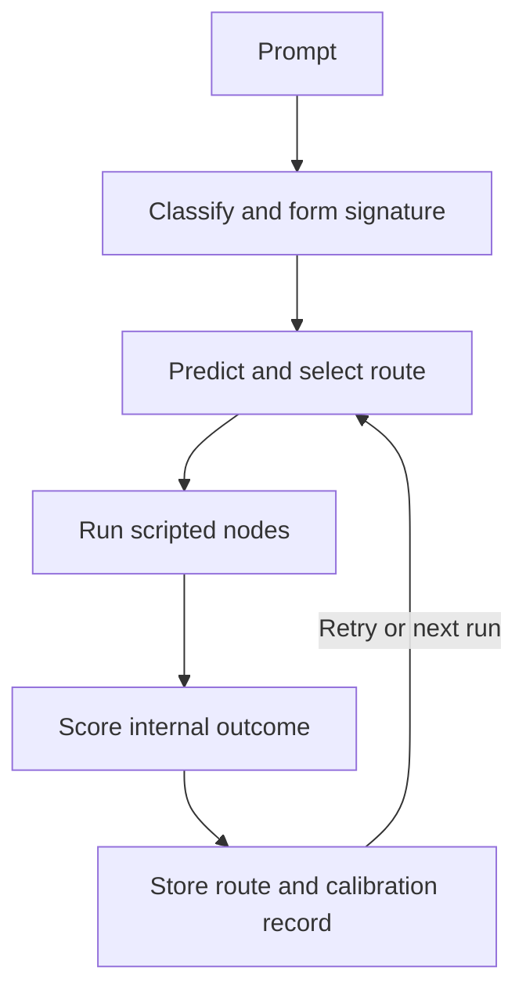

# Regret-Aware Agent Scaffold

A dependency-free Python **routing simulator** for studying how an agent controller can remember prior routes and calibrate predictions after each attempt. Created by Daniel Jacob Read IV and Shane Travis Horman (ĀRU Intelligence).

This is a scaffold with scripted specialist nodes. It does not call an LLM, browse, solve arbitrary prompts, measure cognition, or validate real-world task success. Its “quality” and “confidence” are internal proxy values defined by the code.

## Run it

Requires Python 3.9 or newer; no package installation is needed.

```bash
python3 regret_aware_scaffold.py --runs 5
python3 regret_aware_scaffold.py --prompt "Research a route evaluation method" --runs 3 --json
python3 regret_aware_scaffold.py --runs 5 --memory-file route_memory.json
python3 -m unittest discover -s tests -v
python3 benchmark.py --runs 5
```

The optional memory file stores route observations as local JSON. Without it, memory lasts for the current process only. The benchmark deliberately uses fresh in-memory runtimes so its results are independent of saved files.

## How the loop works



Route memory stores only the selected specialist route. Calibration compares past outcomes for the same task signature, route, and retry depth. Sparse observations are blended with the initial heuristic instead of replacing it outright. A `historical_regret` record describes the gap to a previous observed score at that depth; it is **not** a counterfactual estimate of an untried route.

## Reproducible internal comparison

`benchmark.py` runs each prompt five times in two arms: **cold** creates a new runtime for every attempt; **warm** reuses the same runtime for that prompt. The table compares rounds 2–5. These are deterministic examples with fixed scripted nodes, not independent task labels.

| Prompt | Mean executed nodes, cold → warm | Mean absolute prediction error, cold → warm | Mean internal quality, cold → warm |
|---|---:|---:|---:|
| Design | 26 → 26 | 0.186 → 0.073 | 0.666 → 0.666 |
| Research | 26 → 26 | 0.236 → 0.114 | 0.646 → 0.646 |
| Mixed | 37 → 26 | 0.267 → 0.084 | 0.667 → 0.658 |

The warm controller predicts its own proxy score more closely on these fixtures and uses one fewer retry on the mixed fixture. Its internal quality score is slightly **lower** on that fixture. This is evidence of a software behavior change, not evidence that it gives better answers or has become more intelligent. Run the command above to inspect all individual records and challenge these results.

## What this repair addresses

- Task signatures are now formed after the signal is available, so saved observations can be retrieved on a later run.
- Stored routes are comparable to planner candidates; old full execution traces are excluded from route hints.
- The quality function charges the selected specialist route and a separate retry penalty rather than charging every control and evaluation node repeatedly.
- Calibration can move predictions up or down using outcomes at the same retry depth.
- Displayed confidence is capped by the internal score after evaluation; a failed gate cannot still report a perfect score.
- A small CLI, regression tests, and a cold/warm comparison replace the previous demo's unverified improvement claims.

## Research boundary

The evaluator and specialists are hand-authored. No ground-truth outcome or held-out real task is available here. Better calibration to this evaluator can coexist with worse real-world performance. A stronger next experiment would define externally graded tasks and compare this planner against a fixed policy with matched prompts, budgets, and independently specified success criteria.

MIT licensed; see [LICENSE](LICENSE). Project concepts relate to the [Divine Whisper lineage](https://github.com/aruintelligence/divine-whisper-ecosystem) and Inward Physics™ research.


## Decision Evidence Lab (experimental, opt-in)

The **ĀRU Decision Evidence Lab** adds a measurable research workflow without changing the default scaffold. It is a **routing experiment**, not a deployed LLM, a verified improvement in task performance, or evidence of AGI. It logs the probability of each selected specialist route, accepts **separately graded** outcomes, compares candidate routing policies with inverse-propensity weighting, and generates a polished offline HTML dashboard.

**Quick start: reproducible synthetic demonstration**

```bash
python3 experiment_cli.py demo --out-dir demo-report --n 900 --seed 7
# Open demo-report/index.html locally
python3 -m unittest discover -s tests -v
```

The synthetic generator intentionally assigns different success probabilities to three scripted routes. The results **only verify the evaluation pipeline**. The report prominently identifies synthetic data and *always* blocks rollout, even if the candidate appears superior.

**Actual decision logging (no fabricated outcome labels)**

```bash
# Create prompts.txt yourself, with one non-sensitive task per line.
python3 experiment_cli.py collect --prompts prompts.txt --decisions experiment-data/decisions.jsonl --epsilon 0.25 --seed 7

# Independently evaluate a completed route with a preregistered rubric.
# Replace DECISION_ID with the ID printed by collect.
python3 experiment_cli.py label \
  --decisions experiment-data/decisions.jsonl \
  --labels experiment-data/labels.jsonl \
  --decision-id DECISION_ID --reward 0.8 \
  --grader external-evaluator-1 --rubric-id rubric-v1 \
  --source-kind external

python3 experiment_cli.py evaluate \
  --decisions experiment-data/decisions.jsonl \
  --labels experiment-data/labels.jsonl \
  --baseline-policy greedy --candidate-policy shortest \
  --report-json experiment-data/report.json \
  --report-html experiment-data/index.html
```

The `collect` command uses an opt-in `ExperimentRuntime` with **one specialist route per task and no retries**. The original `MasterAgentRuntime` remains unchanged. This matters: assigning a final outcome to one action would be misleading if a later retry changed the result. The logged action is chosen with epsilon-greedy randomization, and the stored propensity is validated against the logged candidate set. No raw prompt, name, or user ID is written to the decision log. Task signatures and routes may still reveal information; use non-sensitive inputs and appropriate data retention policies.

**What is estimated**

- **IPS:** mean of externally graded rewards weighted by inverse logged action probability; may exceed the reward range in finite samples.
- **SNIPS:** self-normalized IPS estimate; more stable in some cases but generally biased in finite samples.
- **ESS:** effective sample size, warning of weak support even when the log is large.
- **Paired bootstrap difference:** the candidate minus baseline SNIPS on the *same resampled tasks*. The percentile interval is exploratory and assumes independent observations.
- **Conservative human-review screen:** checks sample size, complete labels, overlap, ESS, weight clipping, label provenance, and whether the exploratory lower interval exceeds a specified uplift. **It never authorizes automatic policy rollout.**

Available deterministic candidate policies are `greedy` (original highest-score route), `shortest` (fewest nodes), and `evidence_first` (first route containing the evidence node, otherwise greedy). The baseline and candidate policies must be chosen *before* collecting outcomes to avoid selection bias. This implementation does not learn a new production policy from its own internal quality score.

**Scientific and engineering limits**

1. Specialist nodes are scripted placeholders. Their internally generated quality metrics are **not** valid external labels. External graders must use a fixed rubric and ideally be blind to the route chosen.
2. The logging policy can adapt as memory changes. Standard independent-task bootstrap intervals are not automatically valid for adaptive data, repeated tasks, correlated users, or delayed rewards. A preregistered prospective experiment with cluster-aware or sequential inference is needed for consequential claims.
3. Self-attested external labels are not cryptographically authenticated. JSONL is a **single-process research log**, not a transactional or tamper-proof enterprise ledger. It requires authorization, privacy review, secure storage, provenance, and independent audit before production use.
4. The report measures policy value on observed task contexts only. It cannot establish improvements on new tasks, changes in distribution, or arbitrary real-world outcomes.
5. The review gate is an advisory screening tool, not a causal proof, regulatory certification, or authorization to deploy.

**Commercialization path:** integrate an actual task executor and independent grader, preregister external benchmark rubrics, randomize policy assignments under a fixed task budget, add authenticated append-only event storage, validate on held-out customers/tasks, and provide governance/rollback before selling an enterprise decision-assurance product.

The GitHub Actions workflow tests Python 3.9 and 3.12, runs the existing internal benchmark, generates a synthetic evidence report, and publishes that report as a workflow artifact. No external Python dependencies are required.


### Advanced diagnostics and evidence attestation

The report also includes an **out-of-fold doubly robust (DR) diagnostic**. A shrinkage reward model is trained on other folds and predicts outcomes using the pre-decision task signature and route. The model is deliberately simple and is not independently validated; the DR estimate is a second estimator, **not a second experiment**. Domain-level segment diagnostics flag an observed negative policy difference only when both policies have minimum effective support. These are investigation signals, not demographic fairness claims or confirmatory tests.

For an auditable research handoff, create a checksum manifest over the decision log, outcome labels, and JSON report:

```bash
python3 experiment_cli.py attest \
  --decisions experiment-data/decisions.jsonl \
  --labels experiment-data/labels.jsonl \
  --report-json experiment-data/report.json \
  --manifest experiment-data/attestation.json

python3 experiment_cli.py verify \
  --decisions experiment-data/decisions.jsonl \
  --labels experiment-data/labels.jsonl \
  --report-json experiment-data/report.json \
  --manifest experiment-data/attestation.json
```

For **HMAC authentication**, securely provision an environment variable named `ARU_EVIDENCE_HMAC_KEY` with at least 16 bytes of secret material and add `--hmac-key-env ARU_EVIDENCE_HMAC_KEY` to both commands. Do not commit or share the secret. An HMAC-authenticated manifest can detect modifications when the key remains private; it does **not** prove the underlying labels are truthful, stop someone deleting the files, or make JSONL immutable. Store the attestation outside the experimental data store to establish a separate trusted anchor.

**Commercial safety principle:** a policy can show a positive overall estimate while performing worse in a specific task domain. The human-review screen blocks advancement when a sufficiently supported domain exhibits a material observed decline. Even a passed screen cannot trigger automatic rollout.


### Instrument an external agent (vendor-neutral adapter)

A real AI orchestration system can call the dependency-free `external_adapter.log_instrumented_decision` **at the moment it makes a prospective randomized decision**. This creates the same schema used by the evaluator, without importing the scripted scaffold runtime:

```python
from external_adapter import log_instrumented_decision

# These probabilities must come from the ACTUAL randomized controller.
# Here, an external controller has already selected the second route.
event = log_instrumented_decision(
    "experiment-data/decisions.jsonl",
    task_signature="research|public-data",
    candidate_routes=[
        ["research_node", "truth_evidence_node"],
        ["coherence_node"],
    ],
    selected_route=["coherence_node"],
    selection_probabilities=[0.8, 0.2],
    predicted_scores=[0.8, 0.5],
)
print(event["decision_id"])  # Join an independent outcome later.
```

The adapter validates full-support categorical probabilities, their sum, candidate identity, and the logged propensity. **It cannot verify that the external system actually used those probabilities**. Never infer or invent propensities retrospectively, and do not submit tasks where randomized exploration would create unacceptable risk. The adapter is not a production API: there is no authentication, concurrency control, encryption, consent workflow, or verified executor integration. Those remain explicit engineering requirements.


### Falsification benchmark: known ground truth

`scientific_validation.py` generates a contextual bandit with three routes, three task signatures, and **published analytic reward probabilities**. Unlike a self-scoring demo, the true expected policy uplift is known from the simulator's explicit probability table. Repeated randomized trials measure IPS, SNIPS, and cross-fitted DR estimation bias, absolute error, RMSE, and exploratory interval coverage:

```bash
python3 scientific_validation.py --trials 40 --n 900 --seed 7 --json validation.json
```

This is a genuine, falsifiable **software/statistics test**, but it is **not evidence of a better real-world AI**: the reward-generating distribution is artificial, the tasks are scripted, and no independent customer outcomes are used. Passing such a test means the estimators behave plausibly on this specified environment. The next scientific milestone is a prospective, externally graded, held-out evaluation on real tasks with an agreed baseline and budget.


## Human-annotated, independently scored retrieval benchmark

The `squad_benchmark.py` experiment moves beyond synthetic rewards to **actual retrieval decisions** scored against independently published human annotations from the [Stanford SQuAD v1.1 development dataset](https://rajpurkar.github.io/SQuAD-explorer/). The dataset is CC BY-SA 4.0 and **is not included in this repository**.

Two fixed, dependency-free algorithms see the same **question and source passage, but never the annotated answers**:

- **Baseline:** lexical question/sentence overlap normalized for sentence length.
- **Challenger:** sentence-level BM25/IDF with query coverage, token proximity, and a modest numeric-question cue.

The outcome is 1 if the selected sentence **fully contains a human-annotated answer span** and 0 otherwise. This is a legitimate sentence-retrieval benchmark, **not a complete QA system, an LLM benchmark, or proof of agent intelligence**. Both routes run on each question for a direct *full-information audit*. Separately, a 50/50 randomized logging policy reveals only the selected route's reward to the off-policy evaluator. The report compares off-policy estimates with the directly observable true policy difference on the same fixed benchmark questions.

```bash
# Download from Stanford (dataset not redistributed by ĀRU):
curl -fL https://rajpurkar.github.io/SQuAD-explorer/dataset/dev-v1.1.json -o dev-v1.1.json

# Reproducible evaluation of a fixed hash-selected 2,000-question subset:
python3 squad_benchmark.py --dataset dev-v1.1.json \
  --out-dir benchmark-report --limit 2000 --seed 20261018 --replicates 400
# View benchmark-report/index.html
# Inspect benchmark-report/oracle.json for full-information scores.
```

GitHub Actions workflow `squad-human-gold.yml` downloads the official dataset during the run, prints its SHA-256, executes the benchmark, and uploads only the resulting reports. The raw dataset is not committed or archived. Benchmark labels derive from human-annotated answer offsets, but the grading implementation is ours and must be independently audited before claims about performance. The SQuAD *development* set is public; these are reproducible exploratory measurements, **not hidden-test leaderboard results**. Any later tuning on the same data invalidates treating that data as an untouched holdout.

The strongest scientific claim supported by this benchmark is about the **specific sentence retrieval algorithms on the specific annotated task**. It does not prove a general improvement in the underlying Divine Whisper scripted agent, nor does it establish a commercial product.
