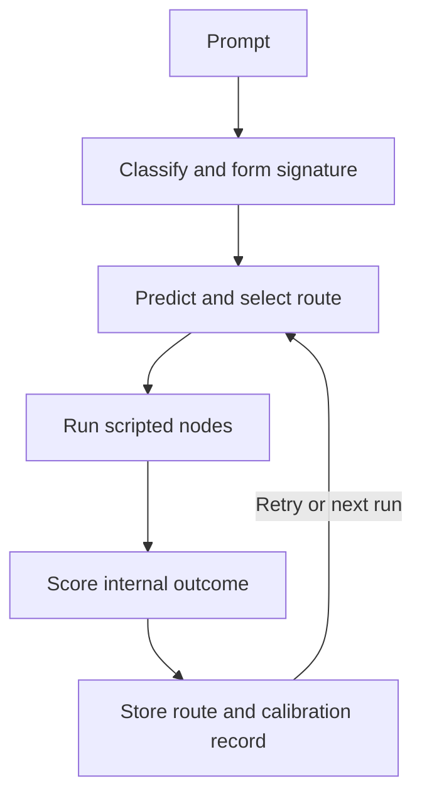

# Regret-Aware Agent Scaffold

A dependency-free Python **routing simulator** for studying how an agent controller can remember prior routes and calibrate predictions after each attempt. Created by Daniel Jacob Read IV and Shane Travis Horman (ĀRU Intelligence).

This is a scaffold with scripted specialist nodes. It does not call an LLM, browse, solve arbitrary prompts, measure cognition, or validate real-world task success. Its “quality” and “confidence” are internal proxy values defined by the code.

## Run it

Requires Python 3.9 or newer; no package installation is needed.

```bash
python3 regret_aware_scaffold.py --runs 5
python3 regret_aware_scaffold.py --prompt "Research a route evaluation method" --runs 3 --json
python3 regret_aware_scaffold.py --runs 5 --memory-file route_memory.json
python3 -m unittest discover -s tests -v
python3 benchmark.py --runs 5
```

The optional memory file stores route observations as local JSON. Without it, memory lasts for the current process only. The benchmark deliberately uses fresh in-memory runtimes so its results are independent of saved files.

## How the loop works



Route memory stores only the selected specialist route. Calibration compares past outcomes for the same task signature, route, and retry depth. Sparse observations are blended with the initial heuristic instead of replacing it outright. A `historical_regret` record describes the gap to a previous observed score at that depth; it is **not** a counterfactual estimate of an untried route.

## Reproducible internal comparison

`benchmark.py` runs each prompt five times in two arms: **cold** creates a new runtime for every attempt; **warm** reuses the same runtime for that prompt. The table compares rounds 2–5. These are deterministic examples with fixed scripted nodes, not independent task labels.

| Prompt | Mean executed nodes, cold → warm | Mean absolute prediction error, cold → warm | Mean internal quality, cold → warm |
|---|---:|---:|---:|
| Design | 26 → 26 | 0.186 → 0.073 | 0.666 → 0.666 |
| Research | 26 → 26 | 0.236 → 0.114 | 0.646 → 0.646 |
| Mixed | 37 → 26 | 0.267 → 0.084 | 0.667 → 0.658 |

The warm controller predicts its own proxy score more closely on these fixtures and uses one fewer retry on the mixed fixture. Its internal quality score is slightly **lower** on that fixture. This is evidence of a software behavior change, not evidence that it gives better answers or has become more intelligent. Run the command above to inspect all individual records and challenge these results.

## What this repair addresses

- Task signatures are now formed after the signal is available, so saved observations can be retrieved on a later run.
- Stored routes are comparable to planner candidates; old full execution traces are excluded from route hints.
- The quality function charges the selected specialist route and a separate retry penalty rather than charging every control and evaluation node repeatedly.
- Calibration can move predictions up or down using outcomes at the same retry depth.
- Displayed confidence is capped by the internal score after evaluation; a failed gate cannot still report a perfect score.
- A small CLI, regression tests, and a cold/warm comparison replace the previous demo's unverified improvement claims.

## Research boundary

The evaluator and specialists are hand-authored. No ground-truth outcome or held-out real task is available here. Better calibration to this evaluator can coexist with worse real-world performance. A stronger next experiment would define externally graded tasks and compare this planner against a fixed policy with matched prompts, budgets, and independently specified success criteria.

MIT licensed; see [LICENSE](LICENSE). Project concepts relate to the [Divine Whisper lineage](https://github.com/aruintelligence/divine-whisper-ecosystem) and Inward Physics™ research.

---

### Inward Physics research navigation

[Complete Inward Physics index](https://github.com/aruintelligence/aruintelligence/blob/main/INWARD_PHYSICS.md) · [Daniel Jacob Read IV’s ORCID](https://orcid.org/0009-0000-6133-1872) · [Zenodo DOI series (record index)](https://github.com/aruintelligence/aruintelligence/blob/main/INWARD_PHYSICS.md#zenodo-record-index)

These links index project-authored proposals and simulations; they do not imply independent validation of a physical model.
